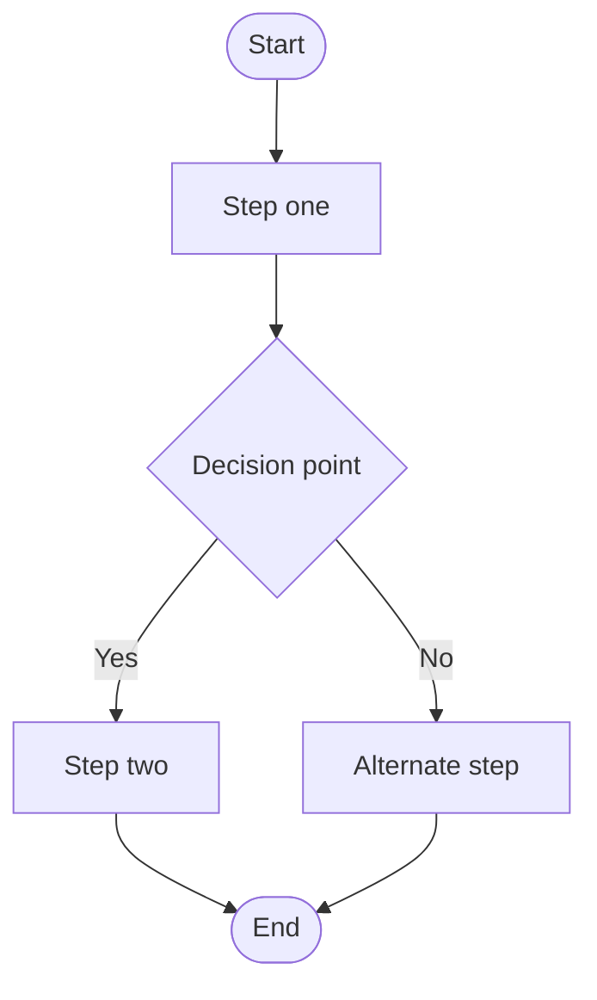
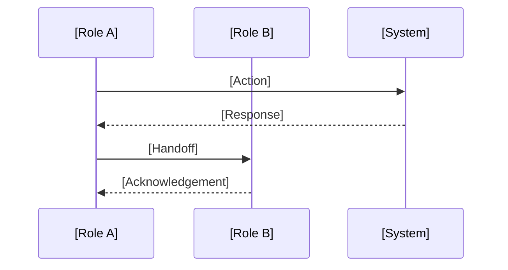

# Spec: [Epic Name]

> **WHAT are we building / changing?**  
> This document is the definitive definition of what this epic delivers. It is the source of truth for implementation, testing, and acceptance.

---

## Overview

_One paragraph. What does this epic deliver and what does it change?_

> [Summary of the deliverable — technical, process, or both]

---

## Scope

| In Scope | Out of Scope |
|---|---|
| [What this spec covers] | [What it does not cover — be explicit] |

---

## Functional Requirements

_What the system or process must do. Each requirement is independently testable._

> **ID format:** `FR-XXX`

### FR-001: [Requirement Name]

**Description:** [What must happen]  
**Actor:** [Who or what initiates this — user, system, scheduled job, external service]  
**Preconditions:** [What must be true before this can occur]  
**Postconditions:** [What is true after this completes]  
**Acceptance Criteria:**
- [ ] [Specific, testable condition]
- [ ] [Specific, testable condition]

---

### FR-002: [Requirement Name]

**Description:**  
**Actor:**  
**Preconditions:**  
**Postconditions:**  
**Acceptance Criteria:**
- [ ]

---

## Non-Functional Requirements

_Quality attributes the solution must satisfy. Linked to success criteria in `intent.md`._

> **ID format:** `NFR-XXX`

| ID | Category | Requirement | Measurement |
|---|---|---|---|
| NFR-001 | Performance | [e.g. p95 latency < 200ms under 1000 rps] | [e.g. Load test in staging] |
| NFR-002 | Security | [e.g. All endpoints require JWT auth] | [e.g. Auth audit in test-plan] |
| NFR-003 | Scalability | [e.g. Must support 10x current load without re-architecture] | [e.g. Capacity model] |
| NFR-004 | Reliability | [e.g. 99.9% uptime SLA] | [e.g. Monitored via Datadog] |
| NFR-005 | Accessibility | [e.g. WCAG 2.1 AA compliance] | [e.g. axe-core scan] |

---

## Data Model

_New entities, modified schemas, field definitions, and constraints._

> **ID format:** `DM-XXX`

### DM-001: [Entity / Table Name]

**Operation:** `CREATE` | `MODIFY` | `DEPRECATE`

```
[Entity Name] {
  field_name    : Type        [constraints, e.g. NOT NULL, UNIQUE]
  field_name    : Type        [description if non-obvious]
}
```

**Notes:** [Migration strategy, backward compatibility, indexing decisions]

---

## API Contracts

_Defined API-first. All contracts are the source of truth for both producers and consumers._

> **ID format:** `API-XXX`

### API-001: [Endpoint or Operation Name]

**Protocol:** `REST` | `gRPC` | `GraphQL` | `Event`  
**Method / Type:** `POST` | `GET` | `PUT` | `DELETE` | `Mutation` | `Query` | `Topic`  
**Path / Topic:** `/v1/resource/{id}`

#### Request

```yaml
# Headers
Authorization: Bearer <token>
Content-Type: application/json

# Path Parameters
id: string (required) — Unique identifier of the resource

# Query Parameters
page: integer (optional, default: 1)

# Body
{
  "field": "type"  # description
}
```

#### Response

```yaml
# 200 OK
{
  "field": "type"
}

# Error Responses
400 Bad Request   — [Condition that triggers this]
401 Unauthorized  — [Missing or invalid token]
404 Not Found     — [Resource does not exist]
422 Unprocessable — [Validation failure, detail in body]
500 Internal      — [Unexpected server error]
```

**Rate Limits:** [e.g. 100 req/min per tenant]  
**Idempotency:** [e.g. Safe to retry with same payload]

---

## User Flows

_Step-by-step behaviour from the actor's perspective. Diagrams are embedded inline._

> **ID format:** `UF-XXX`

### UF-001: [Flow Name]

**Actor:** [Who performs this flow]  
**Trigger:** [What initiates it]  
**Happy Path:**



**Steps:**
1. [Actor] does [action]
2. System responds with [outcome]
3. [Continue...]

**Alternate Flows:**
- **UF-001-A:** [Name] — [When this deviation occurs and how it resolves]

**Error States:**
- [Error condition] → [What the system does / shows]

---

## Process Flows

_For process epics: how work moves through people, teams, or systems._

> **ID format:** `PF-XXX`  
> _(Remove this section for purely technical epics)_

### PF-001: [Process Name]

**Participants:** [Roles or teams involved]  
**Trigger:** [What kicks off this process]  
**SLA / Timing:** [Expected duration or deadline]



**Handoff Criteria:** [What must be true before work moves to the next participant]  
**Escalation Path:** [What happens if SLA is missed or a decision can't be made]

---

## Edge Cases & Error Handling

_What happens when inputs are unexpected, systems are unavailable, or invariants are violated._

| ID | Scenario | Expected Behaviour |
|---|---|---|
| EC-001 | [e.g. Upstream service times out] | [e.g. Return cached response, log warning, alert if >5% of requests] |
| EC-002 | [e.g. Duplicate submission] | [e.g. Idempotent — return existing result, no side effects] |
| EC-003 | [e.g. Invalid input format] | [e.g. 422 with field-level validation errors] |

---

## Dependencies

_Other systems, services, teams, or epics this spec relies on._

| Dependency | Type | Required By | Owner | Risk if Delayed |
|---|---|---|---|---|
| [System / Epic] | `upstream` \| `downstream` \| `shared infra` \| `team` | [FR-XXX / NFR-XXX] | [Team or person] | [Impact] |

---

## Open Questions

_Unresolved decisions that must be answered before or during implementation._

| ID | Question | Owner | Due | Status |
|---|---|---|---|---|
| OQ-001 | [Question] | [Name] | [Date] | `Open` \| `Resolved` |

> Resolved questions should be moved to `decision-log.md`.

---

## Related Artifacts

| Artifact | Link |
|---|---|
| Intent | `intent.md` |
| Plan | `plan.md` |
| Tasks | `tasks.md` |
| Test Plan | `test-plan.md` |
| Decision Log | `decision-log.md` |
